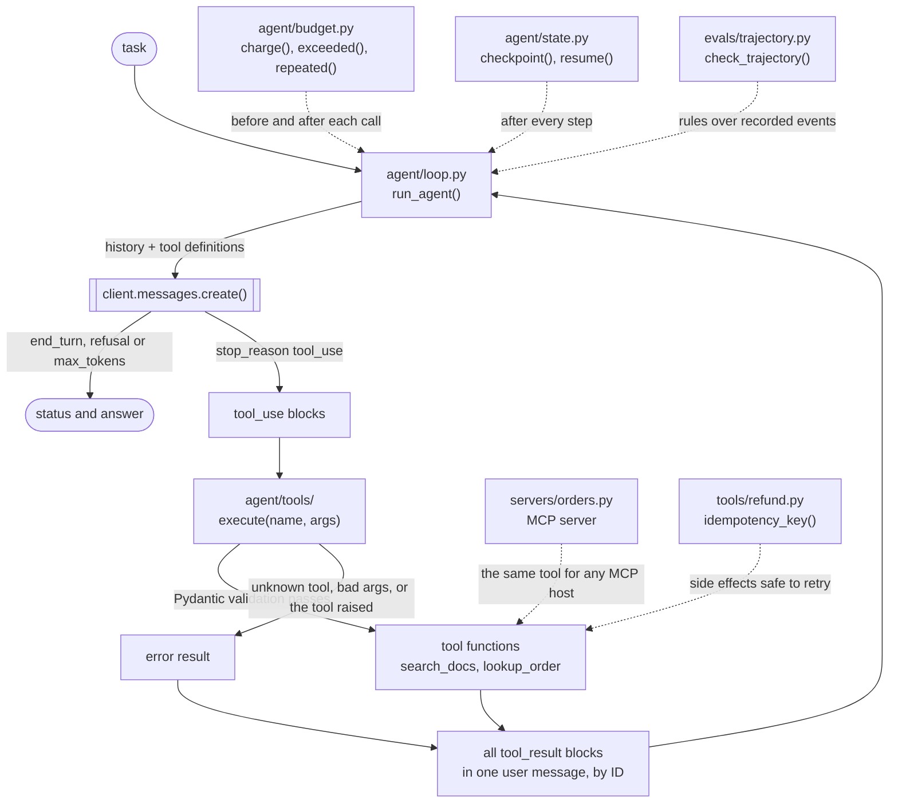
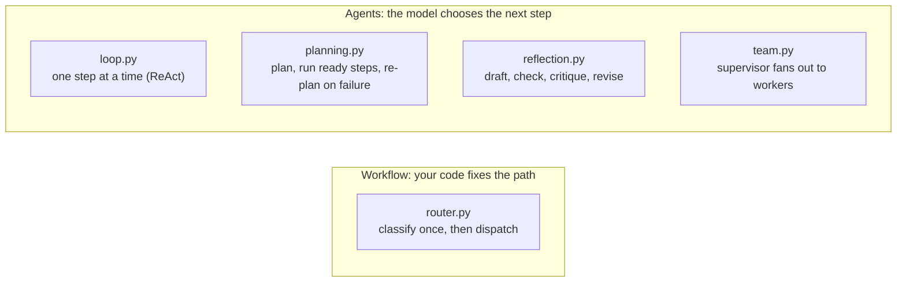

# Guide 02 · Agentic Design Patterns: runnable pattern skeletons

The code skeletons from *Agentic Design Patterns* (Guide 02 of PixioLab AI Mentor), runnable and tested: the raw tool-use loop, a validating tool registry, planning, reflection, routing, a supervisor with parallel workers, budgets, checkpointed state, an MCP server, trajectory checks and idempotent tools. Small examples wire them together so you can watch each pattern's control flow.

## What you'll learn

- What the agent loop really is once frameworks are stripped away, and the four details that make it work in production.
- How a tool registry turns Pydantic schemas into tool definitions and turns bad calls into errors the model can recover from.
- How the five core patterns differ in control flow: tool use (ReAct), planning, reflection, routing and multi-agent.
- How to keep an agent inside the lines with budgets, repeat detection, checkpoints and idempotency keys.
- How to expose a tool over MCP and evaluate an agent's path, not just its answer.

| Guide 02 chapter | Where it lives |
|---|---|
| Chapter 01 · What an agent is, and when to build one | `agent/loop.py` |
| Chapter 02 · Tool use: the ReAct loop | `agent/tools/__init__.py` (printed as `agent/tools.py`), `examples/support_agent.py` |
| Chapter 03 · Planning | `agent/planning.py`, `examples/planning_demo.py` |
| Chapter 04 · Reflection | `agent/reflection.py`, `examples/reflection_demo.py` |
| Chapter 05 · Routing | `agent/router.py`, `examples/router_demo.py` |
| Chapter 06 · Multi-agent systems | `agent/team.py`, `examples/team_demo.py` |
| Chapter 08 · Controls and knowledge | `agent/budget.py`, `examples/budgeted_agent.py` |
| Chapter 09 · Context and tools | `agent/tools/lookup_order.py` |
| Chapter 10 · State, structured outputs and models | `agent/state.py`, `examples/resume_demo.py` |
| Chapter 11 · Protocols and frameworks | `servers/orders.py`, `examples/mcp_client.py` |
| Chapter 12 · Evaluating agents, in brief | `evals/trajectory.py` |
| Chapter 13 · Deploying agents | `tools/refund.py` |

The guide's taxonomy, after Anthropic's ["Building effective agents"](https://www.anthropic.com/engineering/building-effective-agents) (December 2024): **workflows** are paths your code fixes (prompt chaining, routing, parallelization, orchestrator-workers, evaluator-optimizer) and are the default choice; **agents** let the model choose its next step in a loop (the tool-use loop, planning, reflection, multi-agent). Routing here is a workflow; reflection is the agent-side version of evaluator-optimizer.

## Architecture



The other patterns change who decides the next step:



## How a request flows

`python -m examples.support_agent "Where is my order ORD-12345678?"`:

1. **Tools are registered.** `register_tools()` connects the toy backends: it replaces the `search_docs` stub in `agent/tools/__init__.py` and adds `lookup_order` with a Pydantic input model. `search_docs`'s definition is generated from its schema by `tool_definitions()` (Chapter 02); `lookup_order`'s is Chapter 09's hand-written `LOOKUP_ORDER`, whose description says when to use it, when not to, and that it is read-only.
2. **The loop starts.** `run_agent()` in `agent/loop.py` puts the task in the first user message and calls `client.messages.create()` with the tool definitions, at most `max_steps` times (10).
3. **The whole response is kept.** Every block the model returned (thinking, text, `tool_use`) is appended unchanged as the assistant turn. Reasoning models return thinking blocks that some providers require back on the next turn.
4. **No tool call means done.** If `stop_reason` isn't `tool_use`, the loop returns the stop reason and the text blocks joined, so a refusal or a cut-off is reported, not hidden.
5. **Each call runs through the registry.** `execute()` never raises. An unknown tool returns an error that lists the real ones; arguments that fail Pydantic validation return `Invalid arguments: ...` (the example's first call, `"order_id": "12345678"`, fails the `ORD-` pattern); a tool that raises returns its exception as text, such as `LookupError: Order not found...`. Success returns `{"ok": true, "data": ...}`.
6. **All results go back in one message.** Each `tool_result` is matched to its call by `tool_use_id` and flagged `is_error` when it failed. Splitting results across messages teaches the model to stop making parallel calls.
7. **Repeat or stop.** The model reads the results and answers or calls again. At the step cap the loop returns `{"status": "max_steps"}`.

`examples/budgeted_agent.py` is the same loop with Chapter 08's controls in code: it checks `Budget.exceeded()` before every model call, charges tokens and an illustrative cost after it, answers a third identical call with an error result instead of running it, and returns a partial result flagged `budget_exceeded:<limit>` instead of crashing.

The other skeletons take their model calls as plain functions, so you can follow them offline:

- **Planning** (`run_plan()`): reads the next ready step from the *current* plan on every pass, so a revised plan takes effect at once; finished steps stay done; re-plans are capped; a blocked step ends the run as `partial`.
- **Reflection** (`reflect()`): cheap deterministic checks run first, and the model critic only when they pass; the best attempt is chosen by score alone; the loop stops at the cap before paying for a draft nobody checks.
- **Routing** (`route()`, `handle()`, `pick_threshold()`): structured output into a `Route` schema from a small, fast model; requests that are `unclear` or below a threshold chosen from labeled data go to a fallback instead of a guess.
- **Multi-agent** (`run_team()`): workers run in parallel with `asyncio.gather(..., return_exceptions=True)`, failed delegations are retried a fixed number of times, and what still fails is reported as missing.

## File-by-file tour

| File | Responsibility |
|---|---|
| `agent/loop.py` | `run_agent()`: the raw loop, about 30 lines. |
| `agent/tools/__init__.py` | The tool registry: `TOOLS`, `tool_definitions()`, `execute()`. The guide prints it as `agent/tools.py`; it lives in the package so `lookup_order.py` can sit beside it. |
| `agent/tools/lookup_order.py` | A well-designed tool definition: when to use it, when not, formats, a strict schema. |
| `agent/planning.py` | `Step`, `Plan`, `next_ready()`, `run_plan()`. |
| `agent/reflection.py` | `Verdict`, `reflect()`. |
| `agent/router.py` | `Route`, `route()`, `handle()`, `pick_threshold()`. |
| `agent/team.py` | `Delegation`, `SupervisorDecision`, `run_team()`. |
| `agent/budget.py` | `Budget`: steps, tokens, seconds and cost, plus repeat detection. |
| `agent/state.py` | `AgentState` (typed, versioned), `checkpoint()`, `resume()` on SQLite. It opens `runs.db` in the current directory when imported. |
| `servers/orders.py` | An MCP server with one tool, on the MCP Python SDK v2 (`MCPServer`). |
| `evals/trajectory.py` | `check_trajectory()`: rules every good run satisfies. |
| `tools/refund.py` | `idempotency_key()` and `issue_refund()`: a retried step can't refund twice. |
| `examples/support_agent.py` | The loop plus the registry with toy backends; real model calls. |
| `examples/budgeted_agent.py` | Chapter 08's budgets and repeat detection wired into the loop; real model calls. |
| `examples/router_demo.py` | Route labeled requests, pick a threshold, dispatch; real model calls. |
| `examples/planning_demo.py` | Offline: a step fails, the plan is revised, the run finishes. |
| `examples/reflection_demo.py` | Offline: the first draft fails its tests, the second passes the critic. |
| `examples/team_demo.py` | Offline: one flaky worker recovers, one broken worker is reported missing. |
| `examples/resume_demo.py` | Offline: checkpoint each step, crash, resume from the last checkpoint. |
| `examples/mcp_client.py` | Launch the MCP server over stdio, list its tools, call one. No API key. |
| `conftest.py`, `tests/conftest.py`, `tests/fakes.py` | Test setup, the registry reset between tests, and the scripted fake client. |
| `tests/test_*.py` | One file per chapter group: loop, tools, patterns, router, controls, MCP, examples. |

## Key design decisions and trade-offs

| Decision | Why |
|---|---|
| A raw loop, no framework | Everything else in the guide is a variation on these 30 lines. Once you know them, frameworks are a choice, not a mystery. |
| Errors are results, not exceptions | A structured error lets the model retry with different arguments, pick another tool or tell the user; a raised one kills the run. |
| The schema is the definition | One Pydantic model generates the JSON Schema the API needs and validates what the model sends back. |
| Tool descriptions are prompts | Say when to use the tool and when not, the argument formats, what it returns, whether it has side effects. Pair it with errors that teach: "Order not found. Check the order_id format" beats "Error 500". |
| Re-read the plan on every pass | Written as `for step in plan.steps`, the loop keeps iterating the old list after a re-plan, and the failed step's dependents are silently skipped. |
| Deterministic checks before a model critic | A critic that is the same model with the same prompt mostly agrees with itself. Tests, validators and linters add real signal, and they are cheap. |
| Thresholds from data | A model's self-reported confidence is poorly calibrated, so a hard-coded 0.7 is a guess. The share of requests below the threshold is your clarification rate, and users feel it. |
| Multi-agent only when it pays | Anthropic reported multi-agent systems using about 15 times the tokens of a chat interaction. Use them for broad work that splits into independent parts. |
| Budgets enforced in code | A limit written only in the prompt is a suggestion. At a limit, return a partial result with a flag, not a crash. |
| Typed, versioned state, checkpointed every step | Resume after a crash, replay for debugging, pause for approval. New fields get defaults so old checkpoints still load. SQLite keeps the example runnable; use Postgres in production. |
| MCP when more than one agent needs the tool | For one agent, plain functions are simpler. Treat every MCP server as third-party code with access to your agent's context. |
| Rules over the trace, not one reference path | Several paths can be valid. Encode what must and must not happen: no refund without approval, no answer before retrieval. |
| An idempotency key on every side effect | A step that ran but crashed before its checkpoint runs again. The same run, step, tool and arguments give the same key, so the payment API treats the retry as a no-op. |

## Run it

**Prerequisites:** Python 3.11 or later. An Anthropic API key for the three model-backed examples; everything else runs offline.

```bash
cd guide-02-agents
python3 -m venv .venv && . .venv/bin/activate
pip install -r requirements.txt

# Offline: no API key needed
python -m examples.planning_demo
python -m examples.reflection_demo
python -m examples.team_demo
python -m examples.resume_demo        # writes runs.db here (git-ignored)
python -m examples.mcp_client         # starts servers/orders.py over stdio

# Real model calls
cp .env.example .env                  # add your key; ROUTER_MODEL is a small, fast model
set -a; . ./.env; set +a
python -m examples.support_agent "Where is my order ORD-12345678?"
python -m examples.budgeted_agent "Where is my order ORD-12345678?"
python -m examples.router_demo
```

To serve the MCP tool to another host, run `python servers/orders.py` (stdio). For a remote server, change the transport to `"streamable-http"` as the comment in the file says. Version 1 of the MCP Python SDK called the server class `FastMCP`; this code targets v2 (`mcp~=2.3`).

## Test it

```bash
pip install -r requirements-dev.txt
python -m pytest
```

The tests never call a model. `tests/fakes.py` has `ScriptedClient`, a stand-in for `anthropic.Anthropic().messages` that returns scripted responses (thinking, text and `tool_use` blocks) and records every request, so a test can check exactly what the loop sent back, such as all tool results in one message, matched by ID. The router's test also runs the real SDK's `messages.parse()` against an in-memory HTTP transport to check the structured-output request. The MCP tests connect a real MCP client to the server in-process, and once over stdio as a subprocess. `agent/state.py` is imported inside a temporary directory, so no test writes `runs.db` here.

To run against the real API, use the three model-backed examples above with your key set.

## Exercises

1. **Make the support agent durable and supervised.** Combine `budgeted_agent.py` with `agent/state.py` so a crashed run resumes from its last checkpoint, and pause for human approval before a refund (`awaiting_human`), using `tools/refund.py` for the side effect. A bounded multi-agent system with approval gates is Guide 05 · P11 Casefile.
2. **Add guardrails at three points.** Check input before the loop, every tool call before it runs (permissions, amount limits) and the answer before the user sees it (Chapter 08). Then plant instructions inside a tool result and check they are treated as data. Prompt-injection defenses are Guide 05 · P06 Doorman.
3. **Calibrate the router for real.** Label 200 or more requests, record `(confidence, was_correct)` for each, choose the threshold with `pick_threshold()`, and report the clarification rate it implies.
4. **Retrieval as an MCP tool.** Expose `guide-01-rag`'s `search_tool.py` as an MCP server like `servers/orders.py` and call it from the loop, as Week 4 of Guide 00 suggests.
5. **Evaluate the path.** Record each run's tool calls as events and run `check_trajectory()` in a test, then add an end-state check in the style of Guide 03 · Evaluating agents: query the toy order store, not what the agent says it did.

## Differences from the PDF

- The guide prints the tool registry as `agent/tools.py` and the tool definition as `agent/tools/lookup_order.py`. Python can't have a module and a package with the same name, so the registry lives in `agent/tools/__init__.py`; `from agent.tools import execute` works as before. The code is unchanged.
- Every other printed listing matches the PDF line for line. The `__init__.py` files, `examples/` and `tests/` are additions.
