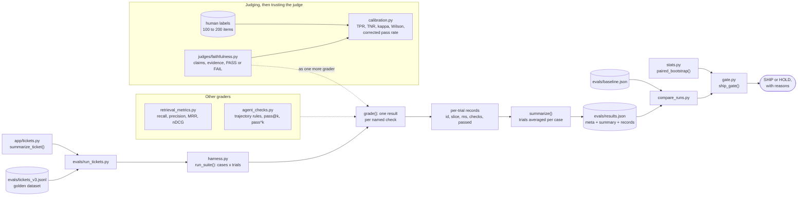

# Guide 03 · Evaluation Field Guide: a tiny eval harness, a judge and a ship gate

The evaluation code from *Evaluation Field Guide* (Guide 03 of PixioLab AI Mentor), runnable and tested against the chapters' worked examples: a harness with code graders, an LLM-as-judge for faithfulness, judge calibration math, paired statistics, retrieval and agent metrics, and a ship gate. A small ticket summarizer is the feature under test.

## What you'll learn

- How to turn "good" into checkable expectations in a golden dataset, with slices you can report on.
- How a harness runs every case several times, records crashes as failures, and averages trials per case before computing anything.
- How to build a binary LLM judge that cites evidence and returns ERROR instead of a silent verdict.
- How to calibrate a judge against human labels with TPR, TNR and Cohen's kappa, and correct the pass rate it reports.
- How to compare two versions on the same cases with a paired test, and gate a release on a non-inferiority margin.

| Guide 03 chapter | Where it lives |
|---|---|
| Chapter 03 · Golden datasets and labels | `evals/support_v7.jsonl` (the printed case), `evals/tickets_v3.jsonl` |
| Chapter 04 · Statistics you actually need | `evals/stats.py` |
| Chapter 05 · Code-based graders and a tiny harness | `evals/harness.py`, `evals/run_tickets.py`, `app/tickets.py` |
| Chapter 06 · LLM-as-judge | `evals/judges/faithfulness.py` |
| Chapter 07 · Calibrating the judge | `evals/calibration.py` |
| Chapter 08 · Evaluating RAG | `evals/retrieval_metrics.py` |
| Chapter 09 · Evaluating agents | `evals/agent_checks.py` |
| Chapter 12 · Regression testing and ship gates | `evals/gate.py`, `evals/compare_runs.py` |

## Architecture



## How a request flows

One evaluation cycle, from a baseline to a ship decision:

1. **Load the cases.** `evals/run_tickets.py` reads `evals/tickets_v3.jsonl`. Each case holds an input, a slice tag (`slice.intent`) and checkable expectations (`expect.category`, `expect.key_facts`), not a single correct text.
2. **Run every case three times.** `run_suite()` in `evals/harness.py` calls the system under test, `summarize_ticket()` in `app/tickets.py`, which asks Claude for JSON constrained to a schema and reads the text blocks by type. Each trial is timed. A crash, such as an API error or a refusal, is recorded as a failed trial with its error, never an aborted run.
3. **Grade with separate checks.** `grade()` runs each grader in `GRADERS` on its own (`valid_category`, `right_category`, `key_facts`), so a failure names the check that broke. A grader that throws on malformed output counts as a failed check. A trial passes only if every check passes.
4. **Summarize per slice.** `summarize()` averages each case's trials first, then reports the pass rate and the number of *cases* per slice and overall: 10 cases with 3 trials are 10 data points, not 30.
5. **Store everything with its versions.** The script writes `meta` (dataset, prompt version, model, commit), the summary and every per-trial record to `evals/results.json`. Keep this file as your baseline.
6. **Change one thing and run again.** Edit the prompt in `app/tickets.py` or set a different `LLM_MODEL`, then rerun.
7. **Compare on the same cases.** `evals/compare_runs.py` turns both runs into what `ship_gate()` expects: one score per case in the same order, the p95 latency, and a cost per task when you record one.
8. **Gate.** `ship_gate()` in `evals/gate.py` applies hard gates first (here, any output with an invalid category). Then `paired_bootstrap()` from `evals/stats.py` resamples cases to get a 95% interval for the difference: if the interval reaches below `-margin` (2 points), a regression can't be ruled out and the answer is HOLD. With `--claim-gain`, the interval must also exclude zero. Cost and p95 latency may rise at most 10%. The script prints SHIP or HOLD with every reason and exits non-zero on HOLD, so it can fail a CI step.

Judging runs beside this loop. `judge_faithfulness(context, answer)` asks a judge model to list every claim in a RAG answer with a supporting quote, then give PASS or FAIL, all constrained to a JSON schema; a refusal, a truncated answer or no text returns `ERROR`. Before you trust its pass rate, label 100 to 200 items yourself and run `calibration()`: TPR and TNR say how often it agrees on good and bad answers separately, kappa corrects for chance, `wilson()` puts an interval on each rate, and `corrected_pass_rate()` (Rogan-Gladen) estimates the true pass rate from the judge's observed one.

## File-by-file tour

| File | Responsibility |
|---|---|
| `evals/harness.py` | `grade()`, `run_suite()`, `summarize()`: the tiny harness. |
| `evals/run_tickets.py` | Runs the harness on the ticket dataset and writes `evals/results.json`. Needs `LLM_MODEL` set. |
| `evals/tickets_v3.jsonl` | Ten illustrative support tickets in three slices, each with a category and key facts. |
| `evals/support_v7.jsonl` | Chapter 03's example case (shown expanded in the guide), with state, must-call and must-not-call expectations, and why it was added. |
| `app/tickets.py` | The feature under test: `summarize_ticket()`, structured output from Claude. Not printed in the guide. |
| `evals/stats.py` | `mcnemar_exact()` for paired pass/fail results and `paired_bootstrap()` for any per-case score. |
| `evals/judges/faithfulness.py` | `judge_faithfulness()`: a binary faithfulness judge with a rubric, evidence and a JSON schema. |
| `evals/calibration.py` | `calibration()`, `wilson()`, `corrected_pass_rate()`, and Chapter 07's worked example, printed when you run the file. |
| `evals/retrieval_metrics.py` | `recall_at_k()`, `precision_at_k()`, `hit_at_k()`, `reciprocal_rank()`, `ndcg_at_k()`. |
| `evals/agent_checks.py` | `trajectory_violations()` over a trace's tool spans, `pass_at_k()`, `pass_hat_k()`. |
| `evals/gate.py` | `ship_gate()`: hard gates, a non-inferiority margin, an optional gain claim, cost and latency budgets. |
| `evals/compare_runs.py` | Not printed in the guide: feeds two `results.json` files to `ship_gate()`. |
| `conftest.py` | Test setup: placeholder key, a closed-port base URL, the working directory. |
| `tests/test_statistics.py` | Chapter 04's worked example: two +2-point gains, only one distinguishable from noise. |
| `tests/test_harness.py` | Grading, crashes as failures, per-case averaging, and `run_tickets.py` end to end with a fake model. |
| `tests/test_judge.py` | The judge's request, its ERROR paths, and the feature under test. |
| `tests/test_calibration.py` | Chapter 07's worked example: TPR 0.938, TNR 0.65, kappa 0.61, the Wilson interval, the corrected rate. |
| `tests/test_rag_and_agent_metrics.py` | Chapter 08's retrieval example, nDCG, trajectory rules, pass@k against pass^k. |
| `tests/test_ship_gate.py` | Every way the gate can say HOLD, and `compare_runs.py` on two runs. |

## Key design decisions and trade-offs

| Decision | Why |
|---|---|
| Checkable expectations, not exact text | Models never write the same sentence twice. Store what a good output must (and must not) do, plus slice tags and the reason each case exists. |
| Several trials per case, averaged per case first | Outputs vary. Trials of one case aren't independent cases, and treating them so makes intervals too narrow. A case that passes two times in three is a reliability problem in its own right. |
| Paired tests on the same cases | McNemar's test for pass/fail and a paired bootstrap for scores use the fact that both versions saw the same inputs. A fixed threshold isn't a significance test, and with 10 cases one case is 10 points. |
| One check per grader, crashes recorded | A failure that names its check is debuggable. A crash is data about the system, not a reason to lose the run. |
| A binary judge with evidence | One criterion, PASS or FAIL, with a quote per claim, is easier to calibrate than a 1 to 10 score. Refusals and truncation become ERROR, never a silent verdict. |
| A different model as judge | Models tend to rate their own outputs generously. Prompt, schema and model ID together are the judge's version: store it with every verdict and recalibrate when it changes. |
| TPR and TNR or kappa, not raw agreement | When 80% of answers are good, a judge that passes everything agrees 80% of the time and catches nothing. The tests show exactly that. |
| Correct the judge's pass rate | An imperfect judge biases the rate it reports. Rogan-Gladen uses TPR and TNR to estimate the true rate, and refuses a judge no better than chance. |
| pass^k beside pass@k | pass@k says one of k tries works; users live with pass^k, every try working. A task that passed 8 of 10 trials has pass@4 of 1.0 and pass^4 of about 0.33. |
| A margin, not "not significantly worse" | Failing to detect a drop isn't evidence there is none. The gate holds unless it can rule out a drop larger than the margin. |
| Hard gates before statistics | Schema-invalid outputs, safety failures and forbidden actions block a change outright, whatever the averages say. |
| A fixed seed | The same data gives the same interval on every rerun, so a changed verdict means a changed system. |

## Run it

**Prerequisites:** Python 3.11 or later. An Anthropic API key for `run_tickets.py` and the judge; the statistics, calibration, metrics and gate run offline.

```bash
cd guide-03-evaluation
python3 -m venv .venv && . .venv/bin/activate
pip install -r requirements.txt

python evals/calibration.py                 # Chapter 07's worked example, offline

cp .env.example .env                        # add your key; LLM_MODEL is required
set -a; . ./.env; set +a
PYTHONPATH=. python evals/run_tickets.py    # 10 cases x 3 trials = 30 model calls
cp evals/results.json evals/baseline.json

# change the prompt in app/tickets.py, or LLM_MODEL, then:
PYTHONPATH=. python evals/run_tickets.py
python evals/compare_runs.py evals/baseline.json evals/results.json
```

The scripts import their neighbors directly (`from harness import ...`, `from stats import ...`), so run them from this folder; `PYTHONPATH=.` lets `run_tickets.py` find the `app` package. To try the judge on one answer:

```bash
PYTHONPATH=evals python -c 'from judges.faithfulness import judge_faithfulness; print(judge_faithfulness("Returns are accepted within 60 days with a receipt.", "You can return items for up to 90 days."))'
```

The `key_facts` grader is a deliberately strict substring check. Paraphrase is what the judge is for: calibrate it, then use it as a grader.

## Test it

```bash
pip install -r requirements-dev.txt
python -m pytest
```

The tests never call a model. The judge and the summarizer are tested with a fake client that returns scripted responses (a thinking block, then text, or a refusal), and once with the real SDK on an in-memory HTTP transport to check the request body: rubric, schema and model. `run_tickets.py` runs end to end with a fake `summarize_ticket()`. The statistics and calibration tests assert the chapters' worked numbers, so if you change the code and they fail, the code no longer does what the guide says.

To run against the real API, use `run_tickets.py` and the judge command above with your key set.

## Exercises

1. **Calibrate the judge.** Label 100 faithfulness cases yourself (context, answer, PASS or FAIL), run `judge_faithfulness()` on each, and report TPR, TNR and kappa with Wilson intervals. Then try a second judge model and compare. That project is Guide 05 · P09 Plumbline.
2. **Gate pull requests.** Run `run_tickets.py` and `compare_runs.py` in CI on every change to `app/` or the dataset, against a baseline committed on main (see `guide-04-production/.github/workflows/evals.yml` for the workflow pattern). The full version is Guide 05 · P02 Tripwire.
3. **Measure retrieval.** Use `retrieval_metrics.py` on a labeled set for `guide-01-rag`, per configuration and per question type, with nDCG on graded labels. That harness is Guide 05 · P01 Groundtruth.
4. **Grade an agent by its end state.** Record traces from `guide-02-agents/examples/support_agent.py`, check them with `trajectory_violations()`, and report pass^k over 10 trials per task.
5. **Feed production back in.** Turn failed production traces into new dataset cases with a slice, a source and a reason, so a fixed bug can't return. That loop is Guide 05 · P16 Flywheel.

## Differences from the PDF

None in the printed code: every listing in Chapters 04 to 12 matches the PDF line for line, apart from blank lines (the PDF prints `run_tickets.py` without the blank lines between its sections). Chapter 03's example case, shown expanded on several lines in the guide, is stored as one line of JSONL. `app/tickets.py`, `evals/tickets_v3.jsonl`, `evals/compare_runs.py` and the tests are additions.
