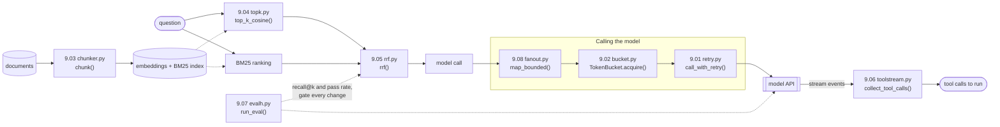

# Guide 07 · AI Engineering Interview Q&A: coding-round solutions

The eight reference solutions from Module 09, "Coding-round patterns", of *AI Engineering Interview Q&A* (Guide 07 of PixioLab AI Mentor), with tests. AI engineering coding rounds rarely ask for puzzles. They ask for the small, load-bearing pieces of an LLM system, and they grade how you reason about failure as much as whether the code runs.

## What you'll learn

- The eight pieces interviewers ask for most, each in under 30 lines: retries, rate limiting, chunking, vector top-k, rank fusion, streamed tool calls, an eval harness and bounded concurrency.
- The edge cases each one must handle, written down as tests you can run.
- How these pieces fit together in a real LLM system, and where the production versions live in this repository.

| Guide 07 · Module 09 | File | Tests |
|---|---|---|
| 9.01 Retry with backoff, jitter and a deadline | `retry.py` | `tests/test_reliability.py` |
| 9.02 Token-bucket rate limiter | `bucket.py` | `tests/test_reliability.py` |
| 9.03 Chunker with overlap | `chunker.py` | `tests/test_retrieval.py` |
| 9.04 Cosine top-k in NumPy | `topk.py` | `tests/test_retrieval.py` |
| 9.05 Reciprocal rank fusion | `rrf.py` | `tests/test_retrieval.py` |
| 9.06 Reassemble streamed tool calls | `toolstream.py` | `tests/test_llm_patterns.py` |
| 9.07 A small eval harness with a ship gate | `evalh.py` | `tests/test_llm_patterns.py` |
| 9.08 Bounded concurrent model calls | `fanout.py` | `tests/test_llm_patterns.py` |

**How to practice:** read the question in the guide, set a timer for 20 to 25 minutes, write your own version, then run these tests against it (copy your file over the solution, or point the imports at yours). Only then read the reference solution and the follow-ups.

## Architecture

Where each piece sits in an LLM system:



## How a request flows

Follow one question through the eight pieces:

1. **Chunk (9.03).** At indexing time, `chunk()` cuts each document's tokens into windows of `size` with `overlap` shared between neighbors, stepping by `size - overlap` and stopping once a window reaches the end, so there is no tiny duplicate tail. Each chunk keeps its `start` and `end` offsets so a citation can point back into the source.
2. **Vector search (9.04).** `top_k_cosine()` normalizes the query and the document matrix so one matrix-vector product gives every cosine score, then `np.argpartition` finds the k best in linear time and only those k are sorted.
3. **Fuse (9.05).** `rrf()` combines the vector ranking with a BM25 ranking using ranks only, `1 / (60 + rank)` per list, counting each document once per list and breaking ties by ID so the output is deterministic.
4. **Bound the fan-out (9.08).** When many calls go out at once, such as summarizing 500 documents, `map_bounded()` holds a semaphore so at most `limit` calls are in flight, gives each its own timeout, and gathers with `return_exceptions=True` so one failure is an exception in its slot instead of a lost batch.
5. **Stay under the rate limit (9.02).** `TokenBucket.acquire()` refills `rate` units per second up to `capacity`, spends the call's cost, or computes the exact wait and sleeps outside the lock. Spend the prompt's estimated tokens to model a tokens-per-minute limit.
6. **Retry what can recover (9.01).** `call_with_retry()` retries 408, 409, 429, 500, 502, 503, 504 and 529 with full jitter, a random delay up to the exponential cap, honors `retry_after` when the server sends it, and gives up before a sleep that would overrun the deadline. Everything else fails fast.
7. **Rebuild the tool calls (9.06).** When the model streams its answer, `collect_tool_calls()` buffers `input_json_delta` fragments by content-block index and parses each call's arguments only when its block closes, because fragments split anywhere, even inside a string. A `max_tokens` stop or a stream that ends inside a call raises.
8. **Gate the change (9.07).** Before any of this ships, `run_eval()` runs each case several times, averages recall@k (skipping out-of-scope questions with no relevant documents) and the pass rate per case, flags cases that pass only sometimes, and returns `ship` against a pass-rate gate.

The production versions are elsewhere in this repository: `guide-04-production/app/llm/client.py` (retries with a total budget and fallback), `guide-04-production/app/queue/limiter.py` (a rate limit shared by every worker through Redis), and `guide-01-rag/rag.py` (chunking, hybrid search with RRF, reranking).

## File-by-file tour

| File | Responsibility |
|---|---|
| `retry.py` | `APIError` and `call_with_retry()`: which errors to retry, full jitter, retry-after, one deadline. |
| `bucket.py` | `TokenBucket`: refill, spend, exact waits, thread-safe, sleeps outside the lock. |
| `chunker.py` | `chunk()`: fixed windows with overlap and offsets; rejects settings that never advance. |
| `topk.py` | `top_k_cosine()`: normalized matrix-vector scores, `argpartition`, clamped k, zero-vector safe. |
| `rrf.py` | `rrf()`, plus the worked two-list example printed when you run the file. |
| `toolstream.py` | `collect_tool_calls()`: Anthropic stream events in, complete tool calls out. |
| `evalh.py` | `recall_at_k()` and `run_eval()`: repeats, per-case averages, flaky cases, a ship gate. |
| `fanout.py` | `summarize()` (one model call, text blocks joined) and `map_bounded()`. |
| `conftest.py` | Test setup: a placeholder key and a closed-port base URL for the client `fanout.py` creates. |
| `tests/test_reliability.py` | 9.01 and 9.02 on a fake clock, so waits are exact and instant. |
| `tests/test_retrieval.py` | 9.03 to 9.05, including the guide's follow-up answers (30 chunks for 10,000 tokens; the RRF scores). |
| `tests/test_llm_patterns.py` | 9.06 to 9.08: split JSON fragments, truncation, flaky cases, the concurrency cap, timeouts. |

## Key design decisions and trade-offs

| Piece | Decision | Why |
|---|---|---|
| 9.01 | Full jitter, a deadline checked before each sleep | Clients that failed together shouldn't retry together, and the whole call must fit the caller's budget. Retry at one layer only: three attempts at three layers is up to 27 calls during an outage. |
| 9.02 | `time.monotonic()`, sleep outside the lock | Wall-clock time can jump; sleeping while holding the lock blocks every other caller. A bucket allows bursts up to capacity; across ten servers, move the state to a shared store. |
| 9.03 | Validate `0 <= overlap < size`, stop at the end | Otherwise the loop never advances, or the last chunk repeats the previous one. |
| 9.04 | `argpartition`, then sort only k | Selection is O(n); a full sort is O(n log n) for results you throw away. At 10 million documents, normalize once and move to an approximate index such as HNSW. |
| 9.05 | Ranks, not scores; once per list; deterministic ties | BM25 and cosine scores live on different scales. When one retriever is much stronger, weight the lists or let a reranker decide. |
| 9.06 | Buffer by index, parse on close | Two tool calls in one response have different indexes; a fragment alone isn't valid JSON. Other providers use other event shapes, but the logic carries over. |
| 9.07 | Repeats, flaky cases, recall skipped when out of scope | Outputs vary, so one run per case hides unreliability. 0.91 against 0.89 on 100 cases is one case: compare versions with a paired test (Guide 03 · Regression testing). |
| 9.08 | Semaphore, per-call timeout, `return_exceptions=True` | A semaphore caps concurrency, not throughput: pair it with 9.02 for a tokens-per-minute limit. For a nightly job, a batch API is usually cheaper. |

## Run it

**Prerequisites:** Python 3.11 or later (the solutions themselves run on 3.10). An Anthropic API key only for 9.08's `summarize()`.

```bash
cd guide-07-coding-round
python3 -m venv .venv && . .venv/bin/activate
pip install -r requirements.txt

python rrf.py        # the worked example: B, A, D, C (B scores 1/62 + 1/61)
python -c "from chunker import chunk; print(len(chunk([str(i) for i in range(10_000)], 400, 60)))"   # 30
```

To run 9.08 for real (set `ANTHROPIC_API_KEY` and `LLM_MODEL` first, see `.env.example`):

```bash
python -c "import asyncio, fanout; print(asyncio.run(fanout.map_bounded(fanout.summarize, ['First document text...', 'Second document text...'], limit=2)))"
```

## Test it

```bash
pip install -r requirements-dev.txt
python -m pytest
```

The tests never call a model. 9.01 and 9.02 run on a fake clock whose `sleep()` advances time instantly, so the tests assert exact waits (the bucket's 0.2 seconds for 30 units, a 1.5-second wait computed rather than polled) without being slow or flaky. 9.06 builds Anthropic stream events by hand. 9.08 passes `map_bounded()` its own async function and counts the calls in flight; `summarize()` is tested with a fake async client.

## Exercises

1. **Answer the follow-ups in code.** Make `call_with_retry()` retry connection errors and per-attempt timeouts too, with each attempt's timeout shorter than the remaining deadline. Compare with `guide-04-production/app/llm/client.py`.
2. **Share the bucket.** Move `TokenBucket`'s state into Redis with an atomic script so ten servers share one quota, then compare it with the fixed-window limiter in `guide-04-production/app/queue/limiter.py`. A gateway with rate limits, budgets and routing is Guide 05 · P05 Switchyard.
3. **Respect structure.** Write a chunker that splits on headings, paragraphs and sentences first, packs units up to the size limit and carries the last unit forward as overlap, then measure it with `run_eval()` against the fixed-window version. Retrieval measurement at portfolio scale is Guide 05 · P01 Groundtruth.
4. **Weighted fusion.** Add per-list weights to `rrf()` and tune them on a labeled set, then add a cross-encoder reranker over the fused top 20, as in `guide-01-rag/rag.py`. Hybrid search with citations is Guide 05 · P04 Sourcebook.
5. **Gate with a judge.** Replace a `check` function in `run_eval()` with a calibrated LLM judge and gate on a paired comparison against the previous version instead of a fixed pass rate. That gate is Guide 05 · P02 Tripwire.

## Differences from the PDF

None: all eight files match Module 09 line for line. `conftest.py` and the tests are additions.
